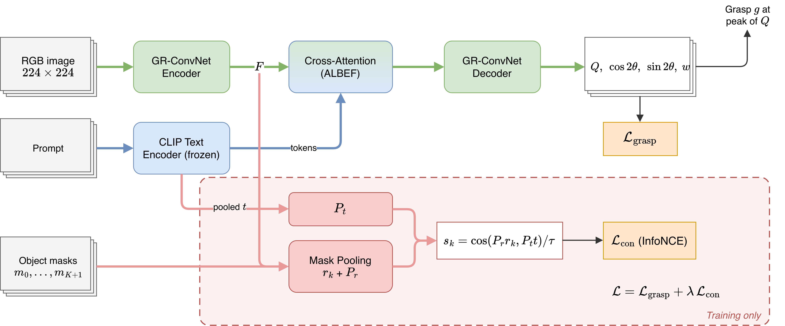

# RTC-Grasp: Region-Text Contrastive Grounding for Language-driven Grasping

Language-driven grasp detection on [Grasp-Anything++](https://airvlab.github.io/grasp-anything/): given an RGB image
and a prompt such as "Lift the hairbrush by its handle.", predict a 2D grasp rectangle (x, y, w, h, θ).

The most common failure of the GR-ConvNet + CLIP baseline is a grasp on the wrong object. RTC-Grasp adds a
region-text contrastive loss during training: the encoder features pooled over the prompted object's mask must match
the prompt's CLIP embedding better than the other objects of the scene and the background. Masks are used in training
only; the network at inference is the baseline's.



## Table of contents

1. [Results](#results)
2. [Installation](#installation)
3. [Dataset](#dataset)
4. [Training](#training)
5. [Evaluation](#evaluation)
6. [Reproducing the official baselines](#reproducing-the-official-baselines)
7. [Project structure](#project-structure)
8. [Acknowledgement](#acknowledgement)

## Results

Success rate (IoU > 25% and angle error < 30°) on the Grasp-Anything++ split of the official LGD code; H is the
harmonic mean of Seen and Unseen. Mean ± std over seeds 123, 124, 125.

| Method | Seen | Unseen | H |
|---|---|---|---|
| GR-ConvNet + CLIP (our implementation) | 0.331 ± 0.019 | 0.392 ± 0.017 | 0.358 |
| RTC-Grasp (λ = 0.01) | **0.365 ± 0.006** | **0.403 ± 0.032** | **0.383** |

With the grasp restricted at inference to a Grounding DINO box or to the ground-truth mask of the prompted object,
Unseen success rises to 0.464 and 0.565 for RTC-Grasp (0.443 and 0.518 for the baseline). Re-run with the authors' code,
GR-ConvNet + CLIP reaches 0.18 on Unseen (0.18 reported) and the released LGD model 0.29 on 168 random Unseen prompts.
Details are in the paper (`paper/`).

## Installation

```bash
git clone https://github.com/hoangducanh1865/PI.git && cd PI/lang_grasp
pip install torch torchvision          # any recent version for your CUDA
pip install -r requirements.txt
pytest                                 # unit tests, CPU, under a minute
```

## Dataset

Download `airvlab/Grasp-Anything` and `airvlab/Grasp-Anything-pp` from Hugging Face into `<RAW>`, then pack them into
HDF5, re-split them into the official LGD split and cache the CLIP text features:

```bash
python scripts/prepare_data.py --raw <RAW> --out <PROCESSED>
python scripts/resplit_lgd.py --src <PROCESSED> --out <DATA>     # 10,130 train / 515 Seen / 212 Unseen objects
python scripts/cache_text_emb.py --processed <DATA>
```

## Training

Configs use [Hydra](https://hydra.cc): `configs/train.yaml` holds the defaults (the authors' settings: Adam, learning
rate 1e-3, batch 8, 50 epochs of 1,000 batches) and `configs/experiment/` one file per model.

```bash
python src/train.py experiment=grconvnet_clip seed=123 paths.data_dir=<DATA>            # baseline
python src/train.py experiment=grconvnet_clip_contrast seed=123 paths.data_dir=<DATA>   # RTC-Grasp
```

Any value can be overridden on the command line (e.g. `model.contrast_weight=0.03`). A run writes its config,
`metrics.csv` and checkpoints (best by Seen success, and `last.ckpt` to resume with `ckpt_path=`) to
`<log_dir>/<experiment>/<date>_<time>/`.

## Evaluation

```bash
python src/eval.py ckpt_path=<CKPT> paths.data_dir=<DATA>                        # Seen, Unseen, H
python src/eval.py ckpt_path=<CKPT> paths.data_dir=<DATA> gate=oracle            # grasp inside the ground-truth mask
python scripts/detect_boxes.py --data <DATA> --out <BOXES>                       # Grounding DINO boxes
python src/eval.py ckpt_path=<CKPT> paths.data_dir=<DATA> gate=detector boxes=<BOXES>
```

Each evaluation writes `results.json` and per-prompt predictions. The failure analysis of the paper's introduction is
`scripts/analyze_errors.py` (automatic sorting) followed by `scripts/judge_failures.py` (two vision-language judges
through any OpenAI-compatible endpoint).

## Reproducing the official baselines

The official LGD code ([Fsoft-AIC/LGD](https://github.com/Fsoft-AIC/LGD), commit 0223d43) is run unchanged:

```bash
bash scripts/lgd_setup.sh      # their code, released checkpoint, official data, Python 3.9 + torch 1.12 environment
bash scripts/lgd_official.sh   # released LGD model and their GR-ConvNet + CLIP, with their README commands
```

`scripts/lgd_shard.py` splits the LGD evaluation (about 74 s per sample on an A100) over several processes without
changing it. In that code, training data is drawn from the Seen test objects, so its models are compared on Unseen only.

## Project structure

The layout follows [lightning-hydra-template](https://github.com/ashleve/lightning-hydra-template).

```
configs/                 Hydra configs: train.yaml, eval.yaml, experiment/ (one per model), paths/ (one per platform)
src/
  train.py, eval.py      entry points
  data/grasp_anything.py dataset and data module (packed HDF5, cached CLIP features, region masks)
  models/
    grconvnet.py         GR-ConvNet with ALBEF cross-attention fusion of the CLIP text tokens
    region_text_contrast.py   the proposed loss
    grasp_module.py      LightningModule: grasp loss + λ x contrastive loss
  utils/grasp.py         grasp maps, decoding, success metric
  utils/platform.py      picks configs/paths/<local|colab|kaggle>.yaml
scripts/                 data preparation, Grounding DINO boxes, failure analysis, official LGD re-run, cloud jobs
tests/                   unit tests
paper/                   LaTeX source of the paper (CVPR template)
```

The same commands run on a local machine, Google Colab and Kaggle: the platform is detected and its paths are read
from `configs/paths/`. The tools to run jobs on Colab and Kaggle from a terminal are in `../scripts/` (see
`../terminal_commands.md`).

## Acknowledgement

The GR-ConvNet network and the grasp maps, decoding and metric are adapted from
[Fsoft-AIC/Grasp-Anything](https://github.com/Fsoft-AIC/Grasp-Anything) (MIT licence), itself based on
[GR-ConvNet](https://github.com/skumra/robotic-grasping); each file header says what was changed. The text encoder is
CLIP ViT-B/32 and the detector Grounding DINO, both from Hugging Face Transformers. The proposed loss, data packing,
evaluation gates and failure analysis are new.

## Author

Duc Anh Hoang
