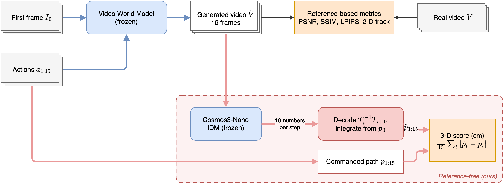

# EVID: Reference-free Evaluation of Action Fidelity in Videos from Robot World Models via Inverse Dynamics

Assignment 2 of the FPT Frontier Innovators 2026 programme (Dr. Ngan Le): evaluating generated videos for robot
trajectories. Action-conditioned video world models predict the video a robot would record when it executes given
actions, and they are scored mostly by how closely their frames match the recorded video. Such appearance metrics need
the real video, which does not exist for new actions, and do not check whether the robot performs the commanded motion.

We reproduce [IRASim](https://github.com/bytedance/IRASim) and its baselines, add Cosmos-Predict2.5, and propose EVID:
an off-the-shelf inverse dynamics model (NVIDIA Cosmos3-Nano) reads the end-effector trajectory back from the generated
video, EVID measures its distance to the commanded trajectory in cm, and inverse kinematics of the WidowX 250 checks
that the real arm could execute it. No real video, no training, no simulator.

Report, videos and a results viewer: [hoangducanh1865.github.io/PI](https://hoangducanh1865.github.io/PI/).



## Table of contents

- [Results](#results)
- [Installation](#installation)
- [Data](#data)
- [Generation](#generation)
- [Evaluation](#evaluation)
- [Figures and viewer](#figures-and-viewer)
- [Project structure](#project-structure)
- [Acknowledgement](#acknowledgement)

## Results

Bridge, 105 test clips (first episodes of 12 instruction verbs), frames 1 to 15. 2-D: NDTW of the end-effector track
against the real clip (96 clips with a verified track). EVID: error in cm, needs no real video. Paper: PSNR reported
by IRASim on its full test set (on 64 random test clips our Frame-Ada reaches 24.85 dB).

| Model | PSNR ↑ | SSIM ↑ | LPIPS ↓ | 2-D NDTW ↑ | EVID cm ↓ | Paper PSNR |
|---|---|---|---|---|---|---|
| IRASim-Frame-Ada (mean of 2 seeds) | <u>23.87</u> | <u>0.808</u> | <u>0.083</u> | <u>0.709</u> | <u>1.82</u> | **25.28** |
| IRASim-Video-Ada | 23.52 | 0.804 | 0.087 | 0.682 | 1.95 | <u>24.73</u> |
| LVDM | 22.62 | 0.788 | 0.103 | 0.593 | 2.54 | 23.55 |
| Cosmos-Predict2.5 (actions) | **25.74** | **0.859** | **0.063** | **0.754** | **1.64** | - |
| *Real video* | - | - | - | 1 | 1.50 | - |
| *Still first frame* | 19.80 | 0.805 | 0.141 | 0.156 | 9.06 | - |

Perturbation test, IRASim-Frame-Ada regenerated from corrupted actions: SSIM rates the still video (0.805) above every
corrupted run and as high as the original actions (0.809), while EVID grows monotonically, 1.81 (original), 2.57 (noise
0.5 cm), 5.46 (noise 1.5 cm), 8.88 (all zero), 14.56 cm (mirrored). Full tables and analysis: the report.

## Installation

```bash
pip install -r requirements.txt     # our code; Python 3.10+, an NVIDIA GPU for generation, EVID and the 2-D track
```

The models run in their own environments, set up by `scripts/setup/` (IRASim at a pinned commit with its pinned
packages; Cosmos-Predict2.5 through its official repo; Cosmos3-Nano served by vLLM-Omni). Paths per platform (Mac,
Kaggle, Colab): `../terminal_commands.md`, section video_eval.

## Data

Only the needed files of the IRASim release (tens of GB per archive) are fetched, then the clips are chosen and their
references written (the real clip, the still first frame, the robot states):

```bash
python scripts/data/fetch_irasim.py get bridge_checkpoints_data --out <DATA> --match 'frame_ada/.*[.]pt$'
python scripts/data/fetch_irasim.py get bridge_train_data --out <DATA> --match '/test/'
bash scripts/setup/irasim.sh <IRASIM> <DATA>
python scripts/data/select_episodes.py --data <DATA> --out <GEN> --per-verb 6 --verbs put move take open close flip fold wipe turn pour slide topple
PYTHONPATH=<IRASIM>/pkgs python scripts/data/make_references.py --data <DATA> --out <GEN>
python scripts/data/make_perturbed_annotations.py --data <DATA>          # corrupted actions for the perturbation test
```

## Generation

```bash
python src/generate/irasim.py --irasim <IRASIM> --model frame_ada --seed 3407 --out <GEN>     # also video_ada, lvdm
bash scripts/setup/cosmos.sh <COSMOS>
python src/generate/cosmos.py --cosmos <COSMOS> --data <DATA> --gen <GEN> --variant action    # base: without actions
```

The full chains run unattended: `scripts/jobs/kaggle_irasim.sh` (IRASim on a Kaggle T4 pair),
`scripts/jobs/a100_cosmos.sh` (Cosmos clips and EVID), `scripts/jobs/a100_perturb.sh` (perturbation test),
`scripts/jobs/a100_seeds.sh` (more Frame-Ada seeds for best-of-N).

## Evaluation

Every metric writes `<GEN>/metrics_<name>.csv`, one row per model and clip.

```bash
python src/metrics/pixel.py --gen <GEN> --models frame_ada/seed3407 still                     # PSNR, SSIM, LPIPS
python src/metrics/temporal.py --gen <GEN> --models real still frame_ada/seed3407             # DINOv2, warp error
python src/metrics/track2d.py --gen <GEN> --tracker cotracker --models real still frame_ada/seed3407
bash scripts/setup/cosmos3.sh <ENV>                                                           # Cosmos3-Nano server
python src/metrics/evid.py --gen <GEN> --models real still frame_ada/seed3407                 # EVID error (cm)
python src/metrics/executability.py --gen <GEN> --models real frame_ada/seed3407               # WidowX 250, CPU
python src/metrics/judges.py --gen <GEN> --models frame_ada/seed3407 --judges <MODEL> ...     # VLM judges
```

The end-effector points of the 2-D track are checked by the judges with `scripts/data/check_ee_points.py`.

## Figures and viewer

```bash
python scripts/report/make_viewer.py --gen <GEN> --out <SITE> --paper <REPORT.pdf>     # project page, all models
python scripts/report/make_examples.py --gen <GEN> --clips 6_0_32 --panels real:"Real video" frame_ada/seed3407:"IRASim-Frame-Ada" --out <DIR>
python scripts/report/make_strips.py --gen <GEN> --model frame_ada/seed3407 --clips 13_0_0 6_0_32 1183_0_0 --frames 0 8 15 --out paper/fig
python scripts/report/plot_paths.py --gen <GEN> --clip 12_0_16 --out <FIG.pdf>         # paths read back (slides)
```

## Project structure

```
video_eval/
├── src/
│   ├── generate/          irasim.py, cosmos.py: clips from a first frame and actions
│   ├── metrics/           pixel, temporal, track2d (2-D), evid (ours), executability (ours), judges
│   └── utils/             trajectory.py (actions <-> end-effector path, 3-D scores), vlm.py (judge client)
├── scripts/
│   ├── data/              fetch the release, choose clips, references, corrupted actions, end-effector check
│   ├── setup/             environments of IRASim, Cosmos-Predict2.5, Cosmos3-Nano
│   ├── jobs/              unattended runs on Kaggle and on one A100
│   └── report/            viewer, example videos, frame strips, path figure
├── paper/                 the report (CVPR template)
└── requirements.txt
```

Our proposed method is `src/metrics/evid.py` with `src/utils/trajectory.py` and `src/metrics/executability.py`; the
rest reproduces or runs existing models and metrics.

## Acknowledgement

- [IRASim](https://github.com/bytedance/IRASim) (Apache-2.0): models, checkpoints, data and preprocessing, run unmodified.
- [Cosmos-Predict2.5](https://github.com/nvidia-cosmos/cosmos-predict2.5) and Cosmos3-Nano with the action decoding of
  [cosmos-framework](https://github.com/NVIDIA/cosmos-framework) (sources in `src/metrics/evid.py`).
- [CoTracker3](https://github.com/facebookresearch/co-tracker) for the 2-D track; `modern_robotics` and the Interbotix
  WidowX 250 description for inverse kinematics.

## Author

Duc Anh Hoang
